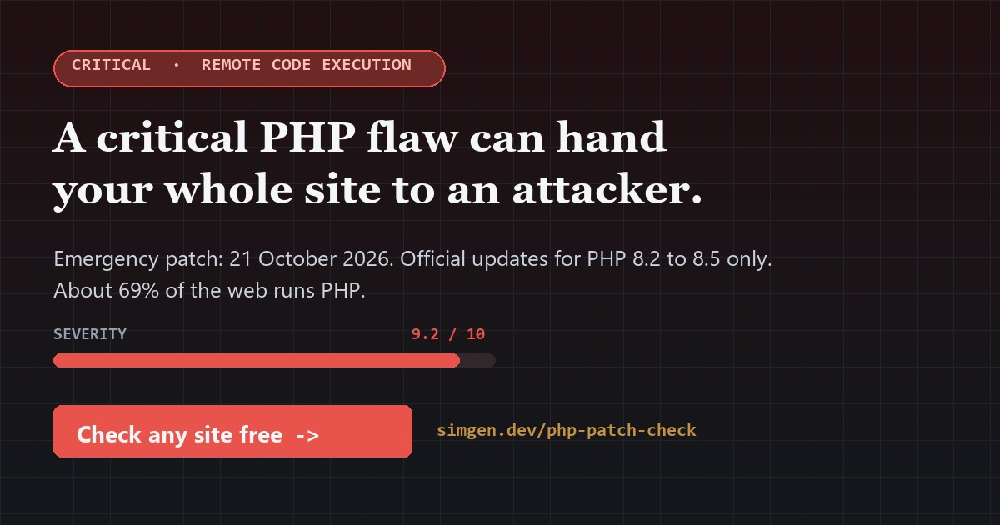
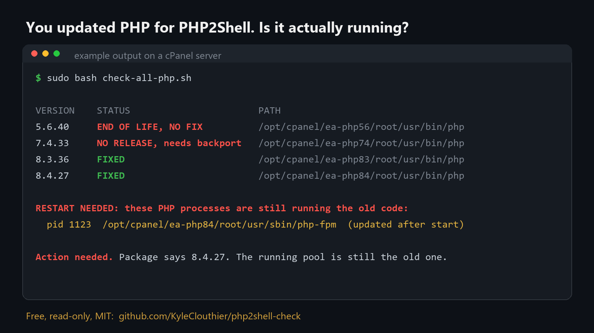

# php2shell-check

[](https://simgen.dev/php-patch-check)

   

Find out in one minute whether a website is on a PHP version that gets the PHP2Shell fix.

**Quick start** (from your site's main folder on the server, or download and upload by FTP):

```sh
curl -O https://raw.githubusercontent.com/KyleClouthier/php2shell-check/main/check-php.php
# then open https://yourdomain.com/check-php.php once. It prints your version and deletes itself.
```

No server access? **[Check any site from the browser](https://simgen.dev/php-patch-check)**, nothing to install.



**Run a server?** Find every PHP install on it (cPanel, Plesk, DirectAdmin, CloudLinux, LiteSpeed, Remi, multi-PHP)
and any PHP-FPM still running old code after an update:

```sh
curl -sO https://raw.githubusercontent.com/KyleClouthier/php2shell-check/main/check-all-php.sh && sudo bash check-all-php.sh
```

```
VERSION    STATUS                       PATH
5.6.40     END OF LIFE, NO FIX          /opt/cpanel/ea-php56/root/usr/bin/php
7.4.33     NO RELEASE, needs backport   /opt/cpanel/ea-php74/root/usr/bin/php
8.3.6      CHECK DISTRO NOTICE          /usr/bin/php8.3
8.4.20     UPDATE to 8.4.27             /opt/cpanel/ea-php84/root/usr/bin/php
8.5.12     FIXED                        /opt/cpanel/ea-php85/root/usr/bin/php

RESTART NEEDED: these PHP processes are still running the old code:
  pid 1123  /usr/sbin/php-fpm8.4  (updated after this process started)
```

It only reads. Exit code 0 means everything found is fixed, 1 means action needed, 2 means no PHP found, so it
drops straight into monitoring or a fleet-wide run.

**Ship code?** [php2shell-action](https://github.com/KyleClouthier/php2shell-action) fails your CI build when the
runner, `composer.json`, a Dockerfile or a workflow still pins a PHP version without the fix:

```yaml
      - uses: KyleClouthier/php2shell-action@v1
```

On 21 October 2026 PHP released emergency fixes for two critical flaws known as PHP2Shell, which can let an attacker
run code on a server without logging in. Updating WordPress, Drupal or your framework does not fix it. The flaw is in
PHP itself.

**Online check, nothing to install:** [simgen.dev/php-patch-check](https://simgen.dev/php-patch-check)
reads a site's public signals (headers, cookies, CMS fingerprints) and tells you what it runs. It stores no web
addresses.

## Who gets a fix

| PHP version | What exists |
|---|---|
| 8.5, 8.4, 8.3, 8.2 | Official releases: **8.5.12, 8.4.27, 8.3.36, 8.2.35**. Install and restart PHP-FPM or the web server. |
| 8.1, 8.0, 7.4 | **No release to install.** php.net published minimal source patches for people who build PHP themselves. You depend on your host having applied one. |
| 7.3 and older | **Nothing.** The only fix is moving to a supported version. |

## Get your exact version: `check-php.php`

Most sites hide their PHP version, so no outside scan can say whether they are patched. This file gives the exact
answer from inside, then removes itself.

1. Download [`check-php.php`](check-php.php).
2. Upload it to your site's main folder (the one with `index.php`, often `public_html`).
3. Open `https://yourdomain.com/check-php.php` once.
4. It prints your version and whether it is end of life, then deletes itself. If it says "please delete this file
   now", delete it by hand.

The whole file is 10 lines. Read it before you upload it.

Other ways to find the version:

- **WordPress:** Tools, then Site Health, then Info, then Server.
- **cPanel:** Software, then Select PHP Version (or MultiPHP Manager).
- **Plesk:** Websites & Domains, then PHP Settings.
- **Shell:** `php -v` (the web server can run a different PHP than the command line, so the file above is the surer answer).

## What to do

- **8.2 to 8.5:** update to the fixed release for your branch and restart PHP so the fix loads.
- **8.1 or older:** ask your host in writing whether they applied the backported fix. If not, move to 8.2 or newer.
  Do it on a staging copy first: that move is what breaks old plugins, themes and custom code.
- **Stopgap only:** `session.upload_progress.enabled = Off` in php.ini is being shared as a temporary measure. PHP's
  advisory says configuration changes do not fully mitigate the flaws.
- **Then check nothing got in:** new admin users, files you did not upload, recently changed files.

## Sources

- [PHP downloads](https://www.php.net/downloads.php) and [supported versions](https://www.php.net/supported-versions.php)
- [PHP security team release announcement](https://news-web.php.net/php.announce/509)
- php.net lists the fixes under advisories GHSA-w8hw-w9fx-j79w and GHSA-6wmf-4rv5-p3rp. The CVE numbers
  circulating online (CVE-2026-109618, CVE-2026-109619) are used in public reporting.

## About

Built by Kyle Clouthier ([simgen.dev](https://simgen.dev)), a full-stack developer who has built and run PHP sites
for twenty years. Need a hand with an old site? [Free review](https://simgen.dev/php-patch-check#fix).

MIT licence.

**If this helped, star the repo so the next person finds it faster, and send it to anyone who runs a PHP site.**
Most site owners have no idea which PHP version they are on.
